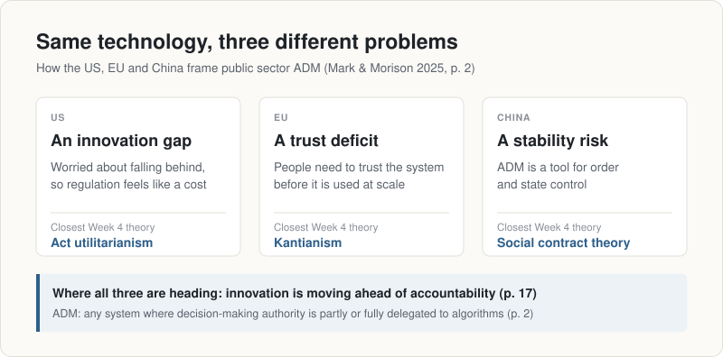
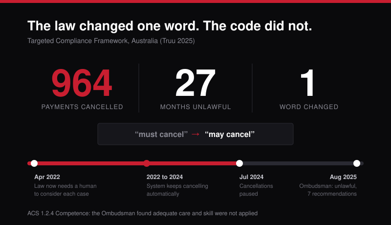
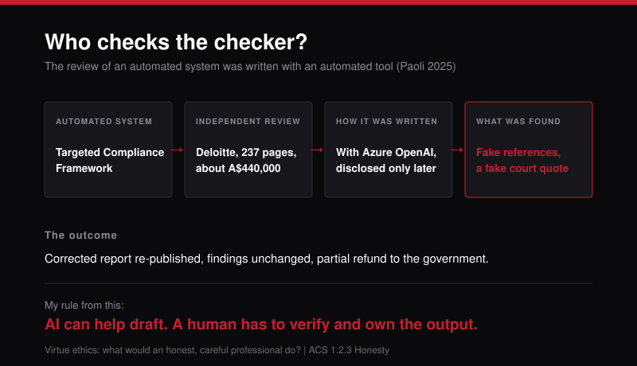
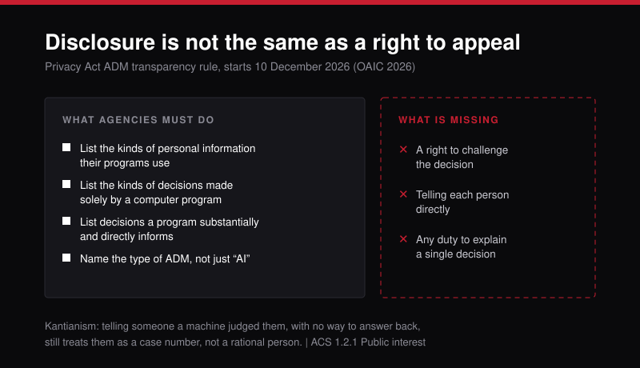
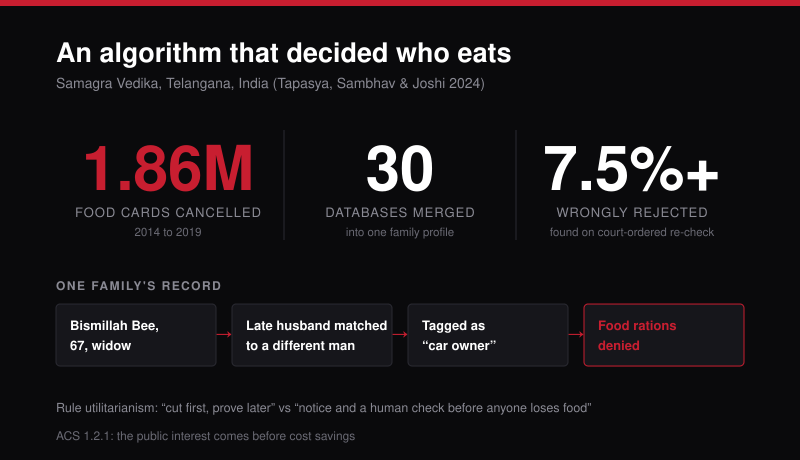
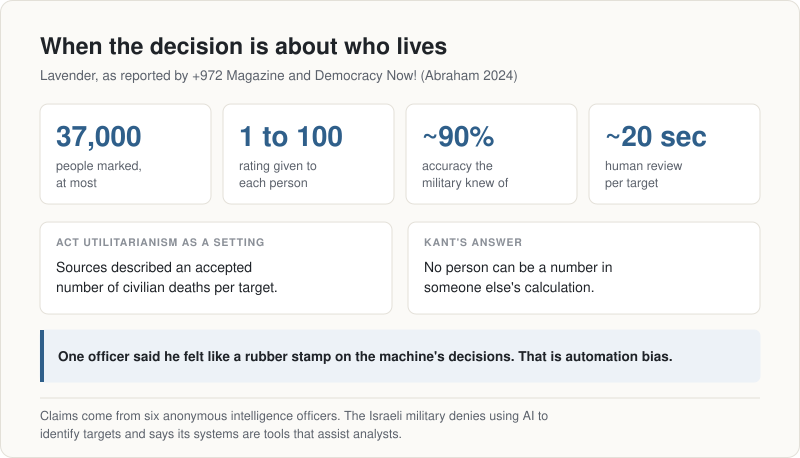

# COIT11223 e-portfolio 5: Automated Decision-Making in Government

Kenil Patel | 12322652 | ICT Ethics and Governance in Society, Term 2 2026

A collection of artefacts that demonstrate what I have learnt about the ethical and societal issues of automated decision-making (ADM) in government systems.

## Where I started

Before this unit I saw ADM as a back-office upgrade. On the service desk I set up rules that blocked spam automatically, and nobody asked whether a filter rule was "ethical". I assumed government ADM worked the same way: if the code followed the rule, the decision was fair. These six artefacts trace how that view changed. I start with what ADM is, then look at three Australian systems that affect welfare and disability support, and finish with India and Gaza, where the decisions were about whether people ate and who was targeted in a war.

| # | Artefact | Type | Where | Main unit link |
|---|----------|------|-------|----------------|
| 1 | Mark & Morison (2025) | Journal article | Global | Comparing ethical theories |
| 2 | Targeted Compliance Framework | News article | Australia | Social contract theory, ACS 1.2.4 |
| 3 | Deloitte's AI-written review | News article | Australia | Virtue ethics, ACS 1.2.3 |
| 4 | NDIS needs assessments | Research commentary | Australia | Kantianism, ACS 1.2.2 |
| 5 | Telangana's Samagra Vedika | Investigative journalism | India | Rule utilitarianism, ACS 1.2.1 |
| 6 | Lavender AI targeting | Video interview | Israel and Gaza | Act utilitarianism vs Kantianism |

---

## Artefact 1: What ADM actually means (journal article, global)

https://doi.org/10.17645/pag.10245

### Summary of the artefact
Mark and Morison (2025, p. 2) describe ADM as "any system in which decision-making authority is partially or fully delegated to algorithms". They compare how the US, the EU and China govern public sector ADM and argue each sees the problem differently: an "innovation gap" in the US, a "trust deficit" in the EU and a "stability risk" in China (Mark & Morison 2025, p. 2). They conclude that all three are drifting towards putting innovation ahead of accountability (Mark & Morison 2025, p. 17).

### Justification on why I chose the artefact
I picked this article because its definition is wide enough to cover both a simple rules engine and a machine learning model, and both appear later in this portfolio. It is also the only artefact that compares whole countries, so it sets the scene before I focus on Australia.

### Reflection
The three framings matched the Week 4 theories better than I expected. The US "innovation gap" reads like act utilitarianism, adding up benefits case by case. The EU's focus on trust is closer to Kant, where people have rights that a calculation cannot override. China's "stability" sounds like a social contract where citizens trade some freedom for order. What I took from this is that a country's ethical starting point shapes the rules ICT professionals end up building under, even when nobody says it out loud.

---

## Artefact 2: When the law changed and the code did not (news article, Australia)

https://www.abc.net.au/news/2025-08-06/commonwealth-ombudsman-finds-payment-cancellation-unlawful/105616010

### Summary of the artefact
Truu (2025) reports on a Commonwealth Ombudsman finding that the Targeted Compliance Framework, the IT system that tracks jobseekers' mutual obligations, automatically cancelled the payments of 964 people between April 2022 and July 2024. Laws passed after Robodebt changed "must cancel" to "may cancel", so a person had to consider each jobseeker's situation first. The system was never updated and kept cancelling on its own.

### Justification on why I chose the artefact
I chose this because it happened after Robodebt, under laws that were meant to stop it happening again. Fewer people know a similar failure happened afterwards. It shows that the lessons from one scandal do not automatically make it into the code, and that ADM can go wrong through poor maintenance, not only poor design.

### Reflection
What struck me is that the law changed one word and the software did not. I have seen a small version of this behind the bar. One night our happy hour button charged every drink at full price, and nobody noticed, not even the guests, until the end-of-night report showed zero happy hour drinks. A failed payment is obvious, but a system quietly doing the wrong thing sits right under your nose. The Ombudsman said adequate care and skill were not applied (Truu 2025), which is close to the ACS value of Competence (1.2.4) (ACS 2014), and its better practice guide says automated systems must meet the same legal standards as a human decision maker (Commonwealth Ombudsman 2025). Under social contract theory, welfare is a two-way deal, but here only the jobseekers were held to it. As a future IT worker, I see keeping a system in line with current law as part of my job.

---

## Artefact 3: The review that was written with AI (news article, Australia)

https://fortune.com/2025/10/07/deloitte-ai-australia-government-report-hallucinations-technology-290000-refund

### Summary of the artefact
Paoli (2025) reports that Deloitte was paid about A$440,000 to review the same Targeted Compliance Framework. A University of Sydney researcher, Chris Rudge, found that the 237-page report cited research and a book that do not exist and included a made-up quote from a Federal Court judgment. The corrected version disclosed that Azure OpenAI had been used, and Deloitte agreed to a partial refund.

### Justification on why I chose the artefact
I chose this because it looks at the system from Artefact 2 from a different angle. The review that was meant to hold an automated system to account was itself produced with an automated tool, and nobody checked it properly before it went up on a government website. It also connects ADM to the generative AI tools I use every week.

### Reflection
This one felt personal. I once set up a flow where AI pulled the context and drafted my emails automatically, and one day it drafted 20 emails, all with the wrong context. I had to rewrite every one myself. It was the same problem as Deloitte's on a smaller scale: an automated tool produced work in my name, and only a human check caught it. Virtue ethics asks what an honest, careful professional would do, and the answer is to check every reference before your name goes on the report. ACS value 1.2.3 Honesty expects us not to mislead the people who rely on our work (ACS 2014). So my rule now is that AI can help me draft, but I read everything before it goes anywhere.

---

## Artefact 4: When a disability plan is decided by a score (research commentary, Australia)

https://www.unsw.edu.au/newsroom/news/2025/10/how-people-are-assessed-for-the-ndis-is-changing-heres-what-you-need-to-know

### Summary of the artefact
Van Toorn and Dickinson (2025) explain that from mid-2026 the NDIS will assess participants over 16 through a three-hour interview using a tool called I-CAN, which scores support needs across 12 areas of daily life. How those scores turn into a budget has not been made clear. Twelve disability organisations later warned that "computer-generated decisions also cannot explain how they reached a conclusion" (People with Disability Australia 2025).

### Justification on why I chose the artefact
I chose this because it is happening in Australia right now, to people who depend on support for everyday life. With the Targeted Compliance Framework we already know what went wrong. Here nobody can say yet whether it will fail, so the ethical question is still open. It also adds disability, a group my other artefacts do not cover.

### Reflection
The line that stayed with me was George Taleporos saying the NDIS "must never reduce us to data points in a secret algorithm" (Van Toorn & Dickinson 2025). That is Kant's second formulation: people are ends in themselves, never just inputs. In the year to June 2025, 73% of appeals against NDIA decisions changed the outcome (People with Disability Australia 2025). So the decisions are already often wrong, and hiding the logic inside an algorithm makes them harder to challenge. The Privacy Act will require agencies to disclose ADM from 10 December 2026 (OAIC 2026), but being told a program was used is different from being able to appeal what it decided. ACS value 1.2.2 asks us to improve people's quality of life (ACS 2014). This connects to what I argued about vulnerability disclosure in Assessment 1: if nobody outside can examine a system, nobody should fully trust it.

---

## Artefact 5: An algorithm that decided who eats (investigative journalism, India)

https://www.aljazeera.com/economy/2024/1/24/how-an-algorithm-denied-food-to-thousands-of-poor-in-indias-telangana

### Summary of the artefact
Tapasya, Sambhav and Joshi (2024) investigate Samagra Vedika, a system the Telangana state government uses to merge data from up to 30 government databases into a profile of each family. Between 2014 and 2019 the state cancelled more than 1.86 million food security cards. A 67-year-old widow, Bismillah Bee, lost her rations because the system confused her late husband with a different man who owned a car.

### Justification on why I chose the artefact
I chose this because it shows ADM failing the poorest people over something as basic as food. It is also from India, where I grew up, so it is the artefact I connect with most and it adds a view from outside Western countries. It also shows how merging many databases can spread small errors across a whole state.

### Reflection
Back home, poorer families get rations at a cheaper price, depending on family size. I have also seen the loophole: eligibility is partly based on occupation, so some people who own farmland but are not farmers can still claim. So I understand why a state wants to check its data, but Samagra Vedika handed that check to a database match and cut people like Bismillah Bee, who really needed the rations. When the Supreme Court ordered a re-check, at least 7.5% of the processed rejections were overturned (Tapasya, Sambhav & Joshi 2024). Under rule utilitarianism, "cut first and let people prove themselves later" may save money on paper, but a rule of giving notice and a human check before anyone loses food would prevent far more suffering. ACS value 1.2.1 puts the public interest before sectional interests (ACS 2014). "Data mismatch" sounds like a technical bug, but for a family in Telangana it meant going without food, so I would treat data matching errors as a safety issue.

---

## Artefact 6: AI in decisions about who lives (video interview, Israel and Gaza)

https://www.democracynow.org/2024/4/5/israel_ai

### Summary of the artefact
In this Democracy Now! interview, journalist Yuval Abraham explains his +972 Magazine investigation into Lavender, an AI system that six Israeli intelligence officers said was used to mark up to 37,000 Palestinians as suspected militants (Democracy Now! 2024; Abraham 2024). Sources said about 10% of those marked were errors and that some reviewers spent around 20 seconds per target. The Israeli military denies using AI to identify targets and says its systems are tools that assist analysts.

### Justification on why I chose the artefact
I chose this because it is the most extreme form of government ADM I found, a system linked to decisions about who lives. I included the military's denial because the claims come from anonymous sources, and I wanted to present the case fairly.

### Reflection
What disturbed me most was how calculated it sounds: sources described an accepted number of civilian deaths per target (Abraham 2024). That is act utilitarianism turned into a setting, and it shows the theory's weakness: any one person can be outweighed. Kant would answer that no person can be a number in someone else's calculation. Twenty seconds of human approval is not meaningful control. It is closer to automation bias, and I have felt a small version of it. During my internship back home, waves of false positives sometimes hit us with 20 or 30 alerts at once. After enough of them your brain gets drained, and that is when you can skip a real positive, while a false negative was our worst nightmare. Our mistakes cost time, and even we struggled. As a cyber security student I may one day be asked to secure systems like this. ACS value 1.2.1 puts the public interest first (ACS 2014), and this artefact made me realise there are systems I would refuse to work on.

---

## What changed for me

I started this unit thinking ADM was neutral. Now I see every automated decision as carrying the choices of the people who designed it, approved it and kept it running. Across these six artefacts, the harm came from a law the code ignored, a review nobody checked, a score nobody can explain, a data mismatch that took away food, and a 20-second approval in a war. Mark and Morison (2025, p. 17) warn that governments are favouring innovation over accountability. As someone heading into cyber security, I want to be the person in the room who asks three questions: does the system match the current law, has a human properly checked the output, and can the people affected see and challenge the decision?

---

## AI usage statement

I used Claude, an AI assistant, to help search for candidate sources, check facts against the original pages, plan the structure, draft the text and generate the six diagrams. I chose the final six artefacts, opened and checked every source and reference myself, and edited the summaries and reflections so they reflect my own views and experience.

---

## References

Abraham, Y 2024, '"Lavender": the AI machine directing Israel's bombing spree in Gaza', *+972 Magazine*, 3 April, viewed 13 October 2026, <https://www.972mag.com/lavender-ai-israeli-army-gaza/>.

Australian Computer Society (ACS) 2014, *ACS code of professional conduct*, version 2.1, ACS, Sydney, viewed 13 October 2026, <https://www.acs.org.au/content/dam/acs/rules-and-regulations/Code-of-Professional-Conduct_v2.1.pdf>.

Commonwealth Ombudsman 2025, *Automated decision-making: better practice guide*, Commonwealth Ombudsman, Canberra, viewed 13 October 2026, <https://www.ombudsman.gov.au/__data/assets/pdf_file/0025/317437/Automated-Decision-Making-Better-Practice-Guide-March-2025.pdf>.

Democracy Now! 2024, *Lavender & Where's Daddy: how Israel used AI to form kill lists & bomb Palestinians in their homes*, video, Democracy Now!, 5 April, viewed 13 October 2026, <https://www.democracynow.org/2024/4/5/israel_ai>.

Mark, D & Morison, J 2025, 'Governing AI decision-making: balancing innovation and accountability', *Politics and Governance*, vol. 13, article 10245, viewed 13 October 2026, <https://doi.org/10.17645/pag.10245>.

Office of the Australian Information Commissioner (OAIC) 2026, *APP 1.7-1.9 transparency obligation: supplementary fact sheet for government agencies*, OAIC, Sydney, viewed 13 October 2026, <https://www.oaic.gov.au/__data/assets/pdf_file/0020/269012/APP-1.7-1.9-Transparency-Obligation-Supplementary-Government-Fact-Sheet.PDF>.

Paoli, N 2025, 'Deloitte was caught using AI in $290,000 report to help the Australian government crack down on welfare after a researcher flagged hallucinations', *Fortune*, 7 October, viewed 13 October 2026, <https://fortune.com/2025/10/07/deloitte-ai-australia-government-report-hallucinations-technology-290000-refund>.

People with Disability Australia (PWDA) 2025, 'Disability representative organisations call for transparency on "computer-generated NDIS plans"', *People with Disability Australia*, 5 December, viewed 13 October 2026, <https://pwd.org.au/disability-representative-organisations-call-for-transparency-on-computer-generated-ndis-plans/>.

Tapasya, Sambhav, K & Joshi, D 2024, 'How an algorithm denied food to thousands of poor in India's Telangana', *Al Jazeera*, 24 January, viewed 13 October 2026, <https://www.aljazeera.com/economy/2024/1/24/how-an-algorithm-denied-food-to-thousands-of-poor-in-indias-telangana>.

Truu, M 2025, 'Automatic systems unlawfully cancelled 964 jobseekers' payments in two years, watchdog finds', *ABC News*, 6 August, viewed 13 October 2026, <https://www.abc.net.au/news/2025-08-06/commonwealth-ombudsman-finds-payment-cancellation-unlawful/105616010>.

Van Toorn, G & Dickinson, H 2025, 'How people are assessed for the NDIS is changing. Here's what you need to know', *UNSW Newsroom*, 2 October, viewed 13 October 2026, <https://www.unsw.edu.au/newsroom/news/2025/10/how-people-are-assessed-for-the-ndis-is-changing-heres-what-you-need-to-know>.
